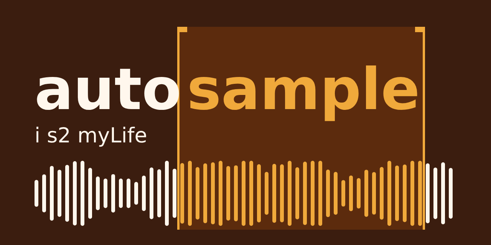
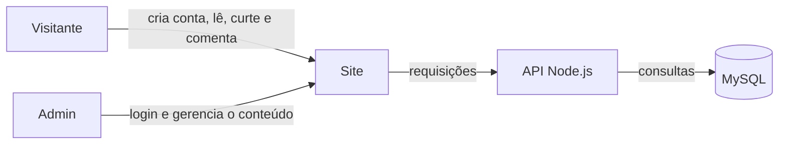

<p align="center">
  
</p>

<h1 align="center">Autosample</h1>

<p align="center">
  <b>Sample da minha própria vida. <i>Rimas, caminhada e bastidores.</i></b>
</p>

<p align="center">
  
  
  
</p>

//capa
<p align="center">
  
</p>


## 🎤 Sobre o projeto

Escrevo rap desde os 17 anos. O Autosample é o meu caderno aberto: um site pessoal que conta a minha caminhada, reúne as letras que saíram de cada fase da vida e mostra o contexto por trás delas.

O nome vem do hip hop. Sample é pegar um pedaço de algo e transformar em outra coisa. Aqui, o pedaço é a minha própria história (*auto*). O subtítulo, **My Life**, é o título do meu "livro da vida", inspirado na música de Roy Ayers, um dos artistas mais sampleados da história do rap.

Projeto individual de faculdade, que conecta três frentes: **técnica** (site com cadastro e login, API em Node.js e banco de dados), **pesquisa e inovação** (como referências culturais e o processo criativo moldam identidade e estilo) e **socioemocional** (autoconhecimento e manejo de emoções através da escrita).

O projeto nasceu com **3 objetivos**:

|   | Objetivo | Descrição |
| - | -------- | --------- |
| ✍️ | **Autoconhecimento** | Transformar vivências, fases difíceis e conquistas em letra, e enxergar a própria evolução ao longo do tempo. |
| 🕰️ | **Memória e processo** | Registrar a caminhada desde os 17 anos e mostrar os bastidores de cada música, da ideia à versão final. |
| 🤝 | **Troca com a cena** | Abrir o caderno para visitantes lerem, curtirem e comentarem, com respeito e sinceridade. |

## ⚙️ Como funciona



**Visitante**
- Cadastro e login para interagir
- Lê as letras (os *samples*), organizadas por fase da vida, tema ou emoção
- Curte e comenta
- Página **"Por trás da letra"** com o contexto de cada música

**Admin (eu)**
- Login com área própria
- Gerencia os marcos da minha caminhada (data, título, texto, foto ou áudio)
- Cadastra e edita letras, com tags de tema, humor e emoção (raiva, superação, saudade...)
- Linha do tempo emocional: gráfico dos meus humores ao longo do tempo

**Se der tempo**
- Mapa das influências (artistas, álbuns, batalhas, shows e o que aprendi com cada um)
- Diário de bordo: etapas de cada música, com humor e motivação em cada uma

## 🛠️ Tecnologias

| Camada | Tecnologia |
| ------ | ---------- |
| API | Node.js, Express |
| Autenticação | JWT e bcrypt |
| Banco de dados | MySQL, modelado e administrado com MySQL Workbench |
| Site | HTML, CSS e JavaScript |

## 📁 Estrutura do repositório

```
autosample/
├── .docs/             # documentação, diagramas, pesquisa e imagens (.assets)
├── backend/           # API Node.js
├── banco-de-dados/    # scripts SQL e diagrama do banco
├── frontend/          # site
├── .gitignore
├── LICENSE
└── README.md
```

## 🚀 Como rodar

> 🚧 Em construção. Esta seção será preenchida conforme o projeto avança.

```bash
git clone <url-do-repositorio>
cd autosample/backend
npm install
cp .env.example .env   # preencha com os dados do seu banco
npm run dev
```

## 🔗 Links

| Documento | Link |
| --------- | ---- |
| Documentação | Em breve |
| Diagrama do banco | Em breve |
| Protótipo das telas | Em breve |
| Pesquisa e inovação | Em breve |
| Gerenciador de tarefas | Em breve |

## 📍 Status

- [x] Ideia e nome definidos
- [ ] Banco de dados modelado
- [ ] API: cadastro e login
- [ ] API: marcos e letras
- [ ] Site
- [ ] Pesquisa e documentação
- [ ] Revisão final

## 👤 Autor

| Nome | Contato |
| ---- | ------- |
| Matheus Santos | matheus.dsantos@sptech.school |

<p align="center"><i>i s2 myLife</i></p>

<p align="center">
  
</p>
