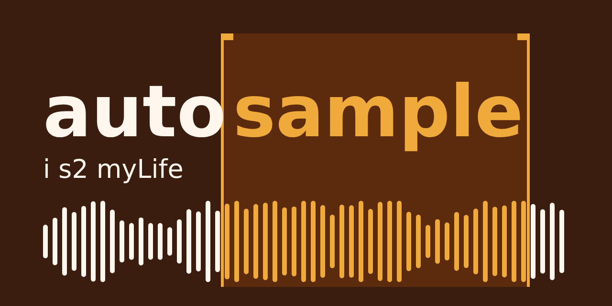
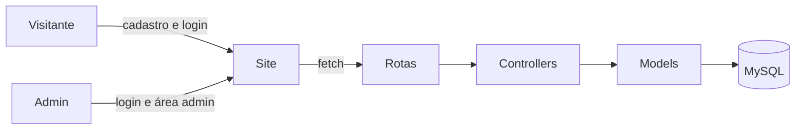
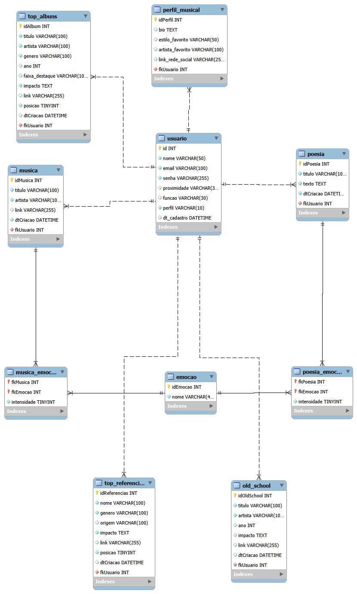

<p align="center">
  
</p>

<h1 align="center">Autosample</h1>

<p align="center">
  <b>Sample da minha própria vida. <i>Rimas, caminhada e bastidores.</i></b>
</p>

<p align="center">
  
  
  
</p>


<p align="center">
  
</p>


## 🎤 Sobre o projeto

Escrevo rap desde os 17 anos. O Autosample é o meu caderno aberto: um site pessoal que conta a minha caminhada, reúne as letras que saíram de cada fase da vida e mostra o contexto por trás delas.

O nome vem do hip hop. Sample é pegar um pedaço de algo e transformar em outra coisa. Aqui, o pedaço é a minha própria história (*auto*). O subtítulo, **My Life**, é o título do meu "livro da vida", inspirado na música de Roy Ayers, um dos artistas mais sampleados da história do rap.

Projeto individual de faculdade, que conecta três frentes: **técnica** (site com cadastro e login, API em Node.js e banco de dados), **pesquisa e inovação** (como referências culturais e o processo criativo moldam identidade e estilo) e **socioemocional** (autoconhecimento e manejo de emoções através da escrita).

O projeto nasceu com **3 objetivos**:

|   | Objetivo | Descrição |
| - | -------- | --------- |
| ✍️ | **Autoconhecimento** | Transformar vivências, fases difíceis e conquistas em letra, e enxergar a própria evolução ao longo do tempo. |
| 🕰️ | **Memória e processo** | Registrar a caminhada desde os 17 anos e mostrar os bastidores de cada música, da ideia à versão final. |
| 🤝 | **Troca com a cena** | Abrir o caderno para visitantes lerem, curtirem e comentarem, com respeito e sinceridade. |

## ⚙️ Como funciona



### ✅ Já funciona
- **Cadastro** com validação no front e no servidor, incluindo a força da senha, checada com um `for`
- **Login** com redirecionamento por perfil: admin vai para a área admin, visitante para a home
- **Home** com o disco de vinil girando 
- **Painel** com dois gráficos (poesias por emoção e intensidade média) e três indicadores
- **Banco** com 6 tabelas, chaves estrangeiras e dois relacionamentos N:M

### 🔜 Planejado
- Cadastro de poesias e músicas pelo site
- Humor do dia, para saber qual emoção mais se repete
- Linha do tempo **Minha caminhada**
- Curtir e comentar
- Banco rodando em uma VM Linux

## 🛠️ Tecnologias

| Camada | Tecnologia |
| ------ | ---------- |
| API | Node.js e Express |
| Banco de dados | MySQL, administrado com MySQL Workbench |
| Acesso ao banco | mysql2 |
| Configuração | dotenv (variáveis no `.env.dev`) |
| Site | HTML, CSS e JavaScript |
| Gráficos | Chart.js |
| Base do projeto | web-data-viz (SPTech) |

## 📁 Estrutura do repositório

```
autosample/
├── .docs/             # documentação e imagens (.assets)
├── public/            # front-end: o que o usuário vê
│   ├── index.html     # home
│   ├── login.html
│   ├── cadastro.html
│   ├── admin.html
│   ├── dashboard/
│   │   └── painel.html
│   ├── css/           # estilo.css, painel.css, home.css
│   ├── js/
│   └── assets/        # imagens
├── src/               # back-end
│   ├── routes/        # caminhos da API
│   ├── controllers/   # validações e regras
│   ├── models/        # queries SQL
│   └── database/      # config.js e script das tabelas
├── app.js             # liga tudo e sobe o servidor
├── package.json       # bibliotecas do projeto
├── .env.example       # modelo das variáveis, sem valores
├── LICENSE
└── README.md
```

## 🗄️ Banco de dados



| Tabela | O que guarda | Chaves |
| ------ | ------------ | ------ |
| `usuario` | Quem se cadastra: nome, e-mail, senha, proximidade, função e perfil | PK `id`; `email` único |
| `poesia` | Título, texto e data de cada poesia | PK `idPoesia`; FK `fkUsuario` |
| `musica` | Título, artista, link e data de cada música | PK `idMusica`; FK `fkUsuario` |
| `emocao` | O catálogo de emoções | PK `idEmocao`; `nome` único |
| `poesia_emocao` | Liga cada poesia às suas emoções, com a intensidade | PK composta (`fkPoesia`, `fkEmocao`) |
| `musica_emocao` | Liga cada música às suas emoções, com a intensidade | PK composta (`fkMusica`, `fkEmocao`) |

**Relacionamentos**
- `usuario` 1:N `poesia`, e `usuario` 1:N `musica`
- `poesia` N:M `emocao`, e `musica` N:M `emocao`, pelas tabelas associativas. A `intensidade` é um atributo **da relação**, e não de uma das pontas.

O script de criação está em `src/database/script-tabelas.sql`, e o modelo editável (abre no Workbench) em `.docs/.assets/DER-Autosample.mwb`.

## 🚀 Como rodar

```bash
git clone <url-do-repositorio>
cd autosample
npm install
cp .env.example .env.dev   # preencha com os dados do seu banco
npm run dev
```

Antes de subir o servidor, crie o banco no MySQL, dê `USE` nele e rode `src/database/script-tabelas.sql` para criar as 6 tabelas.

## 🔗 Links

| Documento | Link |
| --------- | ---- |
| Documentação | Em breve |
| Diagrama do banco | [DER-autosample.png](.docs/.assets/DER-autosample.png) |
| Protótipo das telas | Em breve |
| Pesquisa e inovação | Em breve |
| Gerenciador de tarefas | Em breve |

## 📍 Status

- [x] Ideia e nome definidos
- [x] Banco de dados modelado
- [x] API: cadastro e login
- [ ] API: poesias, músicas e emoções
- [ ] Site
- [ ] Pesquisa e documentação
- [ ] Revisão final

## 👤 Autor

| Nome | Contato |
| ---- | ------- |
| Matheus Santos | matheus.dsantos@sptech.school |

<p align="center"><i>i s2 myLife</i></p>

<p align="center">
  
</p>
