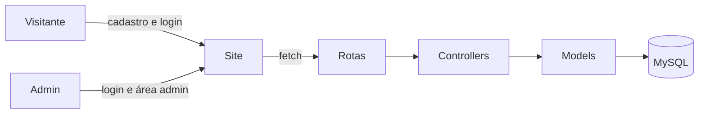

<p align="center">
  
</p>

<h1 align="center">Autosample</h1>

<p align="center">
  <b>Sample da minha própria vida. <i>Rimas, caminhada e bastidores.</i></b>
</p>

<p align="center">
  
  
  
</p>


<p align="center">
  
</p>


## 🎤 Sobre o projeto

Escrevo rap desde os 17 anos. O Autosample é o meu caderno aberto: um site pessoal que conta a minha caminhada, reúne as letras que saíram de cada fase da vida e mostra o contexto por trás delas.

O nome vem do hip hop. Sample é pegar um pedaço de algo e transformar em outra coisa. Aqui, o pedaço é a minha própria história (*auto*). O subtítulo, **My Life**, é o título do meu "livro da vida", inspirado na música de Roy Ayers, um dos artistas mais sampleados da história do rap.

Projeto individual de faculdade, que conecta três frentes: **técnica** (site com cadastro e login, API em Node.js e banco de dados), **pesquisa e inovação** (como referências culturais e o processo criativo moldam identidade e estilo) e **socioemocional** (autoconhecimento e manejo de emoções através da escrita).

O projeto nasceu com **3 objetivos**:

|   | Objetivo | Descrição |
| - | -------- | --------- |
| ✍️ | **Autoconhecimento** | Transformar vivências, fases difíceis e conquistas em letra, e enxergar a própria evolução ao longo do tempo. |
| 🕰️ | **Memória e processo** | Registrar a caminhada desde os 17 anos e mostrar os bastidores de cada música, da ideia à versão final. |
| 🤝 | **Troca com a cena** | Abrir o caderno para visitantes lerem, curtirem e comentarem, com respeito e sinceridade. |

## ⚙️ Como funciona



### O que dá para fazer

- **Acervo público** com poesias, samples, Top 5 referências, Top 5 álbuns e faixas Old School.
- **Admin** para cadastrar, editar e excluir itens do acervo e marcar várias emoções por obra.
- **Meu Perfil** para editar ou excluir a própria conta e cadastrar, editar ou excluir o perfil musical.
- **Dashboard** com dois gráficos (poesias por emoção e intensidade média) e três indicadores.

O login cria uma sessão no servidor. O navegador usa um cookie para identificar a sessão, que dura até oito horas e termina se o servidor for reiniciado. O servidor confirma o perfil da conta antes de permitir alterações no acervo.

## 🛠️ Tecnologias

| Camada | Tecnologia |
| ------ | ---------- |
| API | Node.js e Express |
| Banco de dados | MySQL, administrado com MySQL Workbench |
| Acesso ao banco | mysql2 |
| Configuração | dotenv (variáveis no `.env.dev`) |
| Site | HTML, CSS e JavaScript |
| Gráficos | Chart.js |
| Base do projeto | web-data-viz (SPTech) |

## 📁 Estrutura do repositório

```
autosample/
├── .docs/             # documentação e imagens (.assets)
├── public/            # front-end: o que o usuário vê
│   ├── index.html     # home
│   ├── login.html
│   ├── cadastro.html
│   ├── admin.html
│   ├── acervo.html
│   ├── perfil.html
│   ├── dashboard/
│   │   └── painel.html
│   ├── css/           # estilo.css, painel.css, home.css
│   ├── js/
│   └── assets/        # imagens
├── src/               # back-end
│   ├── routes/        # caminhos da API
│   ├── controllers/   # validações e regras
│   ├── models/        # queries SQL
│   └── database/      # config.js e script das tabelas
├── app.js             # liga tudo e sobe o servidor
├── package.json       # bibliotecas do projeto
├── .env.example       # modelo das variáveis, sem valores
├── LICENSE
└── README.md
```

## 🗄️ Banco de dados

O esquema atual está em [script-tabelas.sql](src/database/script-tabelas.sql). O [DER original](.docs/.assets/DER-autosample.png) documenta o modelo inicial.

| Tabela | O que guarda |
| ------ | ------------ |
| `usuario` | Conta, e-mail único, senha em texto puro, proximidade, função e perfil de acesso |
| `poesia` | Título, versos e autoria |
| `musica` | Título, artista, link e autoria |
| `emocao` | Sete emoções fixas com nomes únicos |
| `poesia_emocao` | Vínculo de cada poesia com suas emoções e a intensidade de 1 a 5 |
| `musica_emocao` | Vínculo de cada música com suas emoções e a intensidade de 1 a 5 |
| `top_referencias` | Referências pessoais com posições únicas de 1 a 5 |
| `top_albuns` | Álbuns de referência com posições únicas de 1 a 5 |
| `old_school` | Faixas Old School, artista, ano e impacto |
| `perfil_musical` | Bio, favoritos e rede social, com um perfil por conta |

Ao colocar várias emoções em uma obra, o HTML oferece os campos, o JavaScript reúne os valores em um vetor e envia um único `fetch`. O controller valida a lista. O model usa a mesma conexão para salvar a obra e seus vínculos em uma transação. Se uma etapa falhar, o MySQL desfaz a operação inteira.

## 🚀 Como rodar

1. Instale as dependências com `npm install`.
2. Copie `.env.example` para `.env.dev` e preencha os dados do MySQL local.
3. Para um banco novo, crie e selecione o schema definido em `DB_DATABASE` no MySQL Workbench e execute [script-tabelas.sql](src/database/script-tabelas.sql).
4. Se o banco já tem as dez tabelas, selecione o schema e execute [atualizar-crud.sql](src/database/atualizar-crud.sql). O script conserva os registros e avisa se houver nomes de emoção ou posições repetidas. Nessa situação, revise os registros apontados antes de rodar novamente.
5. Inicie com `npm run dev` e abra `http://localhost:3333`.

### Primeiro administrador local

Crie sua conta pela tela de cadastro. No MySQL Workbench, com o schema selecionado, promova o e-mail que acabou de cadastrar.

```sql
UPDATE usuario SET perfil = 'admin' WHERE email = 'seu-email@exemplo.com';
```

Entre pela tela de login para abrir o Admin.

## 🔗 Links

| Documento | Link |
| --------- | ---- |
| Documentação |  |
| Diagrama do banco | [DER-autosample.png](.docs/.assets/DER-autosample.png) |
| Protótipo das telas |  |
| Pesquisa e inovação |  |
| Gerenciador de tarefas |  |

## 📍 Status

- [x] Ideia e nome definidos
- [x] Banco de dados modelado
- [x] API: cadastro e login
- [x] CRUD do acervo e do perfil musical
- [ ] Site
- [ ] Pesquisa e documentação
- [ ] Revisão final

## 👤 Autor

| Nome | Contato |
| ---- | ------- |
| Matheus Santos | matheus.dsantos@sptech.school |

<p align="center"><i>i s2 myLife</i></p>

<p align="center">
  
</p>
